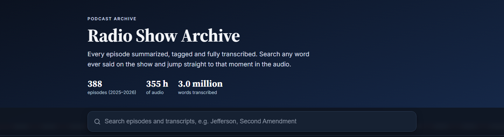

  

  
  
  
  

I build production systems for businesses: ordering portals, integrations with ERP, couriers and e-invoicing, and automations that use AI where it actually saves time. I talk to the people who will use the system, turn what they need into a plan, ship a first version fast and keep improving it with them.

## Selected work

<table>
<tr>
<td colspan="2" valign="top">

<h3>MTC Tactical Assistant · <a href="https://github.com/LektorGW/mtc-tactical-assistant">source on GitHub</a></h3>
Rust · Tauri 2 · React 19 · TypeScript · local OCR · 109 UI tests

A Windows desktop app that reads a game's map and HUD from the screen with local OCR and turns it into a firing solution in a transparent overlay. Ballistics solver with drag and rocket-motor models (RK4), 3D intercept for moving targets, map calibration from two points, 153 projectile profiles for 51 weapons. Core logic is a workspace of 6 Rust crates behind a React UI.

</td>
</tr>
<tr>
<td width="50%" valign="top">

<h3>B2B wholesale ordering portal</h3>
<b>In production</b> · Next.js 15 · React 19 · TypeScript · Prisma · C#/.NET

Customer-specific prices, quick ordering by product code, invoices and balances. My C#/.NET connector syncs orders both ways with the Subiekt GT ERP, shipments go through DHL, InPost and Orlen Paczka APIs, and the sales team gets an AI assistant that only sees pseudonymised data. First working version in a week.

</td>
<td width="50%" valign="top">

<h3>Searchable podcast archive</h3>
<b>Client in the US</b> · Python · Whisper · FFmpeg

388 episodes and 355 hours of audio turned into 3 million searchable words. Every episode summarized and tagged, and search jumps straight to the moment in the audio. Built with a parallel transcription pipeline that survives interruptions.

</td>
</tr>
<tr>
<td width="50%" valign="top">

<h3>Lektoro · 9 Shopify apps</h3>
<a href="https://apps.shopify.com/partners/lektor">Shopify App Store</a> · TypeScript · React Router

EU product compliance (GPSR, EPR), HS codes and customs data, stock and sync monitoring, purchase orders with MOQ, price rounding.

</td>
<td width="50%" valign="top">

<h3>Shopping centre website</h3>
<a href="https://chpanorama.pl">chpanorama.pl</a> · Laravel 11 · Filament · Alpine.js

Interactive floor plan connected to the store directory: level switching, search, zoom and a unit card drawn on the architectural plans. Tenants, promotions and events managed in a Filament CMS.

</td>
</tr>
<tr>
<td width="50%" valign="top">

<h3>Housing development website</h3>
<a href="https://osiedlepodksiazem.pl/">osiedlepodksiazem.pl</a> · React · Vite · Tailwind CSS

Interactive selector drawn on the architectural renders: pick a building, hover a floor to see how many apartments are still available, then open the exact floor plan of a single apartment.

</td>
<td width="50%" valign="top">

<h3>Foundation website &amp; CMS</h3>
<a href="https://electio.org.pl">electio.org.pl</a> · Laravel 12 · Livewire 3 · Filament

Migrated from WordPress to a custom Laravel app with an admin panel: district map, projects and events, online donations through PayU, newsletter with double opt-in, cookie-free analytics and technical SEO.

</td>
</tr>
</table>

<b>More projects</b>

 

- **Bakery operations system** · Next.js 16, Drizzle, KSeF, Dotykačka POS. Raw material stock, recipes with costing, production orders, transfers between shops, national e-invoicing. Built in 4 days part-time with AI coding agents.
- **Roblox** · 3 published games: [Parcel Empire Tycoon](https://www.roblox.com/games/116481735425004/Parcel-Empire-Tycoon) (main project), [Space Garden](https://www.roblox.com/games/101257030687266/Space-Garden) (190+ automated tests) and Rush to the Storm Egg!.
- **Hackathons** · [tender-lens](https://github.com/LektorGW/tender-lens) (on-device + Firebase AI tender analysis) · [mistakemap](https://github.com/LektorGW/mistakemap) (misconception maps for teachers).

## Stack

   
  

## How I work with AI

I use AI coding agents (Claude Code, Codex) every day. I write the spec and acceptance criteria, the agent drafts the change, and I review the diff and test it before anything ships. Business logic, client data and security I check myself: the agent writes faster, but the code is my responsibility.

  Linux Essentials · Cisco Networking Academy · <a href="https://mkaczmarczyk.com">mkaczmarczyk.com</a>

